# Manuel d'utilisation — Dimensionnement des poteaux aux Eurocodes

Version 4.4.0. Document généré par `npm run manuel` à partir de `src/manuel/contenu.ts` ; captures d'écran régénérées à chaque version.

## Sommaire

1. [Présentation](#presentation)
2. [Installation et lancement](#installation)
3. [Prise en main de l'écran](#ecran)
4. [Parcours type : dimensionner un poteau](#parcours)
5. [Référence : étape Données](#donnees)
6. [Référence : étape Armatures](#armatures)
7. [Référence : étape Vérifications](#verifications)
8. [Documents : note, plan, exports](#documents)
9. [Projets à plusieurs poteaux](#projet)
10. [Cartouche et réglages](#reglages)
11. [Sur téléphone et tablette](#mobile)
12. [Méthodes de calcul (résumé)](#methodes)
13. [Dépannage et questions fréquentes](#depannage)
14. [Glossaire des notations](#glossaire)
15. [Historique des versions](#versions)

## 1. Présentation

L'application dimensionne et vérifie des **poteaux en béton armé** selon la NF EN 1992-1-1 (Eurocode 2) et son Annexe nationale française : résistance à l'état limite ultime avec les effets du second ordre, flexion déviée, effort tranchant, états limites de service, résistance au feu (EN 1992-1-2) et dispositions constructives.

Elle produit une **note de calcul** paginée, un **plan de ferraillage** A3 (SVG et DXF) et un **récapitulatif** de projet. Un projet peut contenir plusieurs poteaux.

- **Sections** : rectangulaire, circulaire, hexagonale, demi-cercle, quart de cercle, en L, en T, en croix.
- **Sollicitations** : compression centrée, flexion composée (moments en tête et en pied, dans deux plans), traction, effort tranchant et torsion.
- **Méthodes** : courbure nominale et rigidité nominale (§5.8.7, §5.8.8), méthode simplifiée des Recommandations professionnelles en comparaison.

> Outil de **pré-dimensionnement** : les résultats doivent être vérifiés et validés par un ingénieur structure qualifié. Les hypothèses et limites sont rappelées dans chaque note de calcul.

## 2. Installation et lancement

Prérequis : **Node.js** version LTS (https://nodejs.org) et un navigateur récent : Chrome ou Edge 111+, Firefox 128+, Safari 16.4+.

1. Décompresser l'archive du projet dans un dossier, par exemple `C:\Poteaux-EC2`.
2. Ouvrir un terminal dans ce dossier et lancer `npm install` (une seule fois, connexion Internet nécessaire).
3. Lancer `npm run dev`, puis ouvrir **http://localhost:3000** dans le navigateur.
4. Pour arrêter l'application : `Ctrl + C` dans le terminal.

Une fois installée, l'application fonctionne **hors ligne**. Pour la publier sur un serveur web : `npm run build`, puis déposer le contenu du dossier `dist/`.

## 3. Prise en main de l'écran

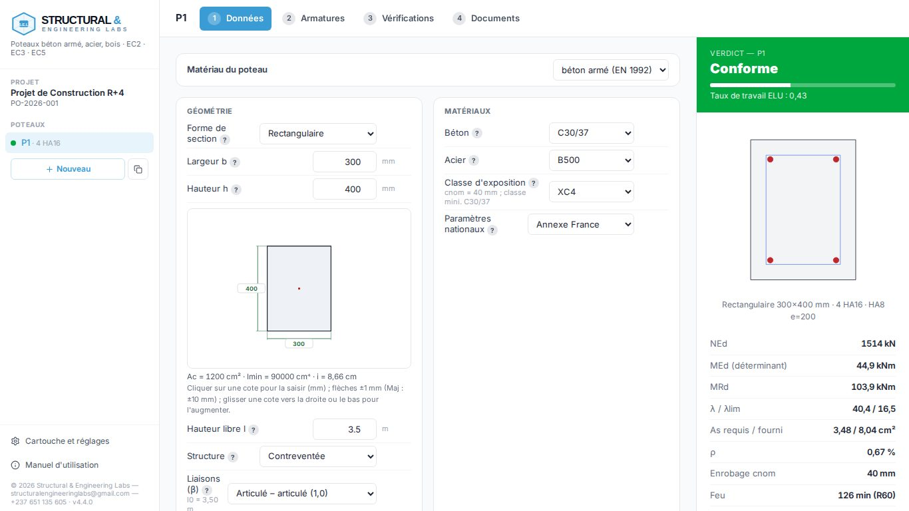

*Figure 1 — L'écran principal : liste des poteaux à gauche, étapes du calcul au centre, résultats à droite.*

- **À gauche** : le projet et ses poteaux (pastille verte, rouge ou orange selon le verdict), les boutons **Nouveau** et **Dupliquer**, les réglages et le manuel.
- **En haut** : les quatre étapes du calcul — **Données**, **Armatures**, **Vérifications**, **Documents**. Raccourcis clavier : `Alt + 1` à `Alt + 4`.
- **À droite** : le panneau de résultats, toujours visible — verdict, taux de travail, coupe de la section, valeurs clés, nombre de vérifications conformes, non conformes et à examiner.

Chaque champ muni d'un bouton **?** donne sa définition, la valeur usuelle et l'article de norme correspondant.

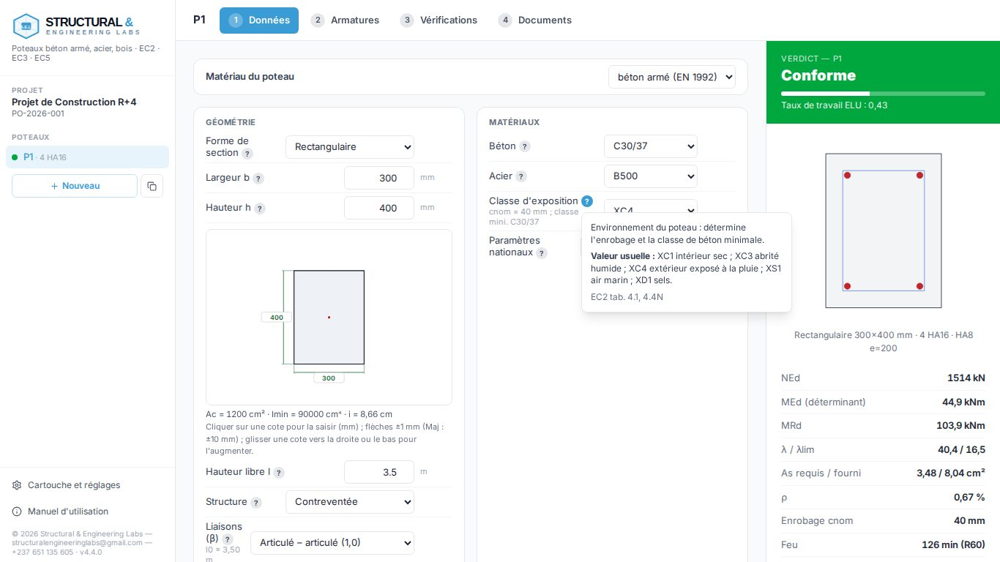

*Figure 2 — Aide contextuelle d'un champ.*

## 4. Parcours type : dimensionner un poteau

1. **Données** — choisir la forme et les dimensions, la hauteur libre et les liaisons, le béton, l'acier et la classe d'exposition. Saisir les charges permanentes G et d'exploitation Q et la catégorie d'usage ; l'effort de calcul NEd s'affiche aussitôt.
2. **Moments** — si le poteau reçoit des moments de poutres, choisir « Flexion composée » et saisir les moments en tête et en pied, avec le type de courbure.
3. **Options avancées** (si nécessaire) — coefficients, fluage, longueur efficace par souplesses, effort tranchant, ELS, exigence de résistance au feu. Fermé, le panneau résume ses réglages.
4. **Armatures** — cliquer sur **Proposer** pour obtenir les ferraillages conformes les plus légers, puis **Appliquer** ; ajuster le diamètre et l'espacement des cadres.
5. **Vérifications** — contrôler la liste : chaque ligne se déplie sur sa justification. Le filtre **À traiter** n'affiche que les points non conformes ou à examiner.
6. **Documents** — générer la note de calcul, télécharger le plan DXF, enregistrer le projet.

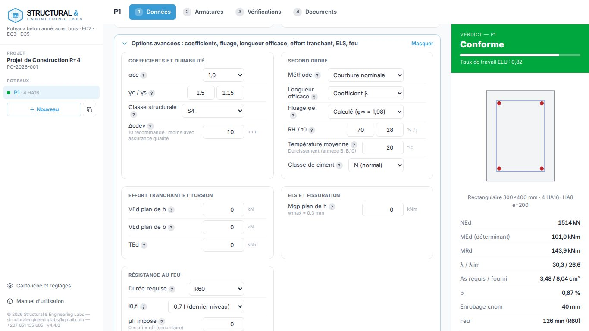

*Figure 3 — Options avancées ouvertes : coefficients, second ordre, effort tranchant, ELS, feu.*

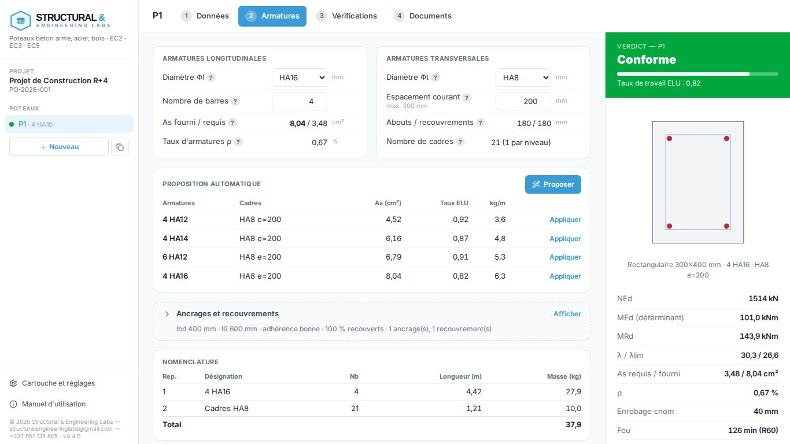

*Figure 4 — Proposition automatique des ferraillages conformes.*

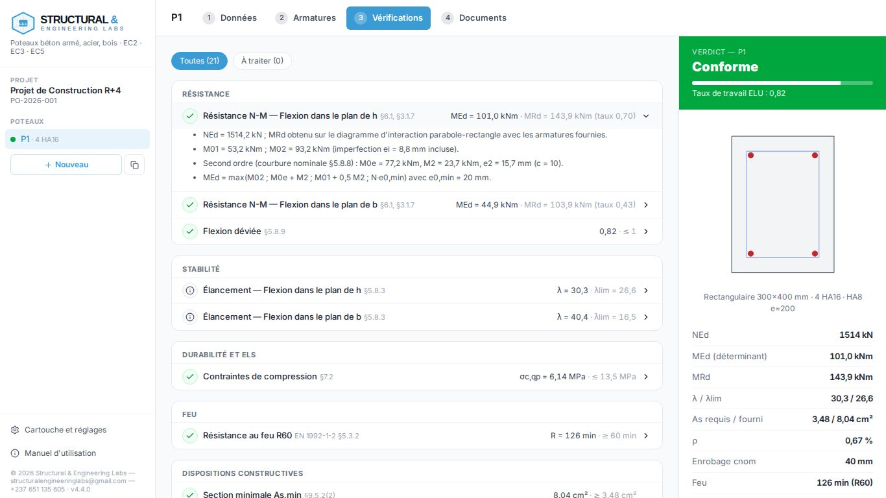

*Figure 5 — Liste des vérifications, avec la justification dépliée.*

## 5. Référence : étape Données

| Rubrique | Contenu | Remarque |
|---|---|---|
| Géométrie | Forme, dimensions (mm, saisie aussi sur le dessin coté : clic sur une cote, flèches, glisser), hauteur libre (m), structure, liaisons β | Pour L, T, croix : calcul dans les axes principaux |
| Matériau | Béton armé, acier (EN 1993 : profilé IPE, HEA, HEB, HEM ou PRS) ou bois (EN 1995 : classe C ou GL, section b × h), charges G et Q ou NEd, moments selon y et z | En acier et en bois, l'étape 2 devient « Paramètres » (γM, kmod, longueurs de flambement, feu) |
| Matériaux | Classe de béton, acier, classe d'exposition, paramètres nationaux | L'enrobage nominal et la classe minimale s'affichent |
| Charges | Type de sollicitation, charges G et Q (ou NEd), catégorie d'usage, poids propre | NEd = 1,35 G + 1,5 Q ; Ncar et Nqp calculés |
| Moments | Tête et pied dans deux plans, courbure simple ou double, charges transversales | Imperfection ajoutée automatiquement |
| Options avancées | αcc, γ, classe structurale, Δcdev, méthode du second ordre, l0, fluage, V et T, ELS, feu | Ouverture automatique si une donnée est invalide |

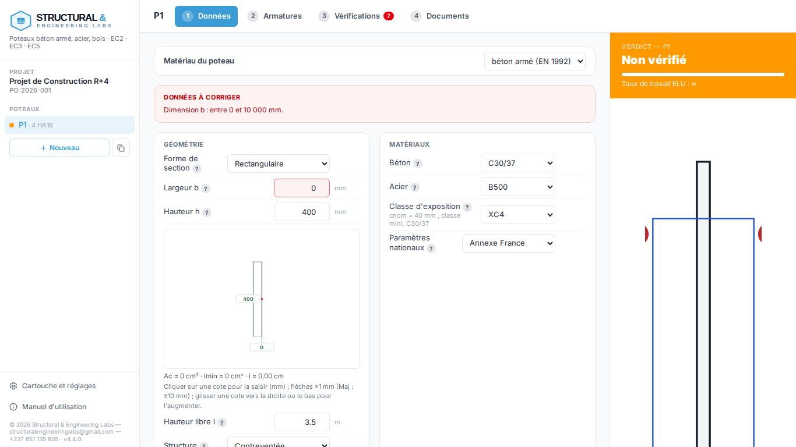

*Figure 6 — Donnée invalide : message, champ encadré en rouge, verdict « non vérifié ».*

## 6. Référence : étape Armatures

- **Armatures longitudinales** : diamètre et nombre de barres ; l'application les répartit (une barre par angle, puis dans les plus grands intervalles) et affiche As fourni et requis.
- **Cadres** : diamètre et espacement courant ; les espacements aux abouts et dans les recouvrements sont calculés (§9.5.3(4)).
- **Proposition automatique** : recherche les solutions conformes les plus légères pour la section et les charges actuelles.
- **Ancrages et recouvrements** : longueurs calculées (§8.4, §8.7) ou saisies en k·Φ ; nombre de zones pour la nomenclature.
- **Nomenclature** : longueurs et masses des barres et des cadres.

## 7. Référence : étape Vérifications

| Groupe | Contenu |
|---|---|
| Résistance | Diagramme d'interaction N-M dans chaque direction, flexion déviée, compression centrée |
| Stabilité | Élancement et élancement limite, fluage effectif, prise en compte du second ordre |
| Effort tranchant | VRd,c, bielles, armatures d'effort tranchant et de torsion (rectangle, cercle) |
| Durabilité et ELS | Contraintes de compression, ouverture des fissures |
| Feu | Méthode A de l'EN 1992-1-2 (rectangle, cercle) |
| Dispositions constructives | Sections minimale et maximale, diamètres, espacements, barres tenues, classe de béton minimale |
| Comparaisons | Méthode des Recommandations professionnelles, courbure et rigidité nominales |

Statuts : **Conforme** (coche verte), **Non conforme** (croix rouge), **Non vérifié** ou **À examiner** (triangle orange), **Information** (i).

## 8. Documents : note, plan, exports

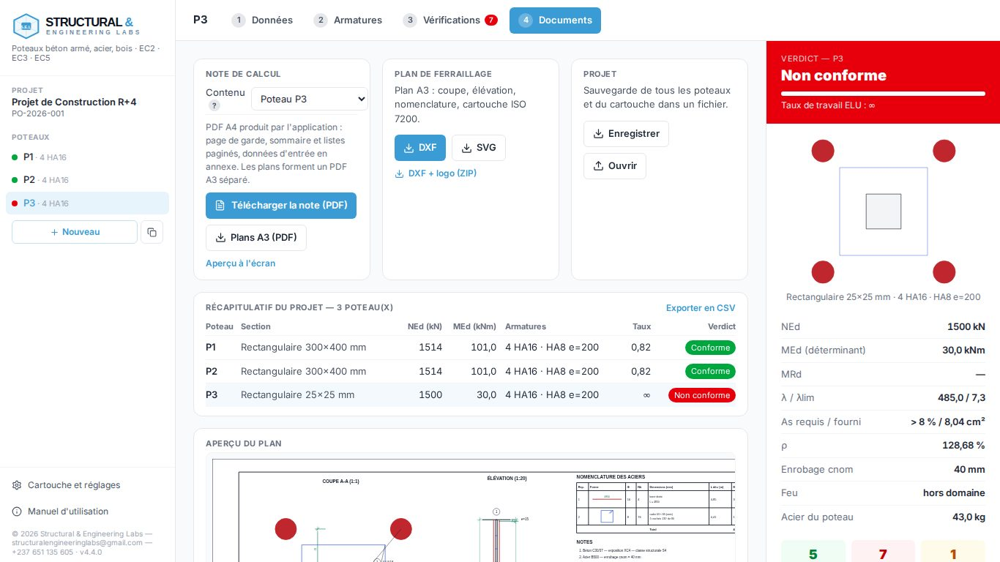

*Figure 7 — Étape Documents : note, plan, projet et récapitulatif.*

**Note de calcul** — choisir le poteau affiché ou tout le projet, puis **Télécharger la note (PDF)** : l'application produit directement un PDF A4 (page de garde, sommaire et listes paginés, équations numérotées, données d'entrée en annexe), sans passer par la boîte d'impression du navigateur. Le fichier est nommé `référence_poteau_note-de-calcul_indice_date.pdf`.

**Plans A3 (PDF)** produit un document séparé, une page A3 paysage par poteau, à l'échelle indiquée dans le cartouche. **Aperçu à l'écran** ouvre la note paginée dans un nouvel onglet, pour la relire ; son bouton **Imprimer / PDF** reste disponible.

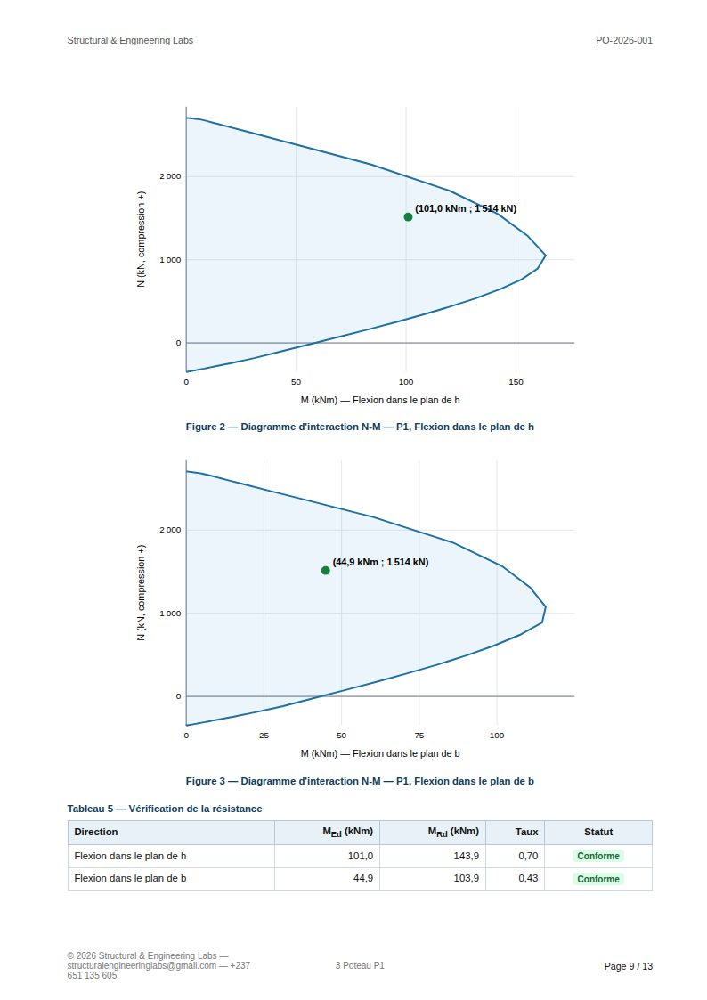

*Figure 8 — Note de calcul (aperçu) : équations numérotées avec article, valeurs et unités.*

**Plan de ferraillage** — A3 : coupe cotée et hachurée, élévation avec zones de cadres, nomenclature façonnée, cartouche ISO 7200. Le DXF (R12) s'ouvre dans les logiciels de DAO ; le cartouche est un bloc à attributs modifiables.

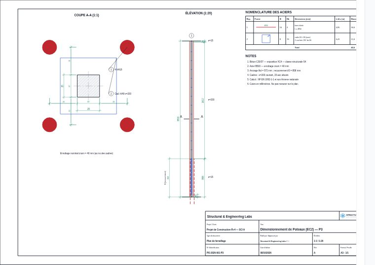

*Figure 9 — Plan de ferraillage A3.*

| Export | Format | Usage |
|---|---|---|
| Note de calcul | PDF A4 | Diffusion, visa, archivage |
| Plans de ferraillage | PDF A3 (un plan par page) | Diffusion, impression à l'échelle |
| Plan | DXF R12, SVG | DAO |
| DXF + logo | ZIP | Plan avec le logo à insérer (le DXF R12 n'incorpore pas d'image) |
| Récapitulatif | CSV | Tableur (Excel, LibreOffice) |
| Projet | .poteaux.json | Archivage, échange, reprise ultérieure |

## 9. Projets à plusieurs poteaux

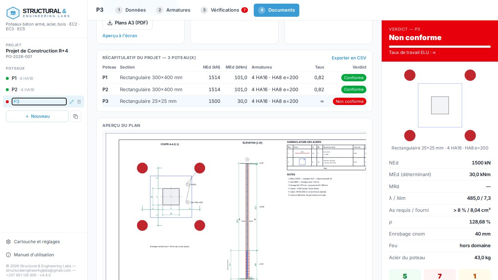

*Figure 10 — Plusieurs poteaux dans un projet et récapitulatif.*

- **Nouveau** crée un poteau avec les valeurs par défaut ; **Dupliquer** (icône de copie) recopie le poteau affiché.
- Double-cliquer sur un nom (ou l'icône crayon) pour le renommer ; l'icône corbeille le supprime.
- Le projet est **enregistré automatiquement** dans le navigateur. **Enregistrer** (étape Documents) produit un fichier `.poteaux.json` ; **Ouvrir** le recharge. Les projets d'une version antérieure sont mis à jour automatiquement, l'original est conservé.

## 10. Cartouche et réglages

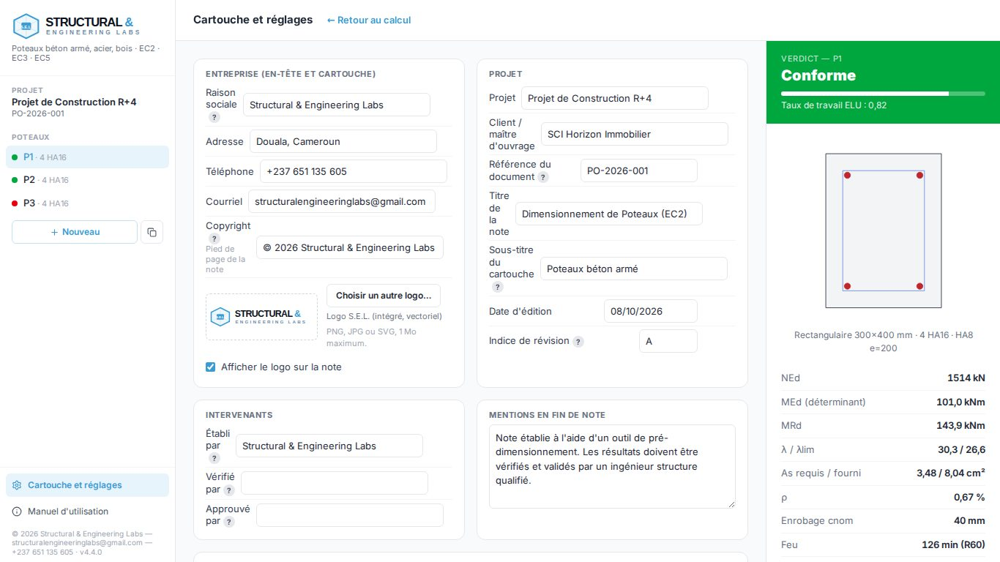

*Figure 11 — Réglages : entreprise et logo, projet, intervenants, révisions, mentions, modèle, diagnostic.*

- **Entreprise** : raison sociale, coordonnées, copyright, logo (PNG, JPG ou SVG, 1 Mo au plus). Le logo S.E.L. est utilisé par défaut ; **Rétablir le logo S.E.L.** le remet après le choix d'un autre logo, et **Identité S.E.L.** rétablit l'identité complète (logo, coordonnées, copyright).
- **Cartouche** : la note reprend le cartouche S.E.L. à trois cellules (logo, projet et référence, rédacteur, date et titre) ; le **sous-titre** (par exemple POTEAUX BÉTON ARMÉ) se règle dans la rubrique Projet.
- **Projet et intervenants** : référence, titre, date, indice ; établi, vérifié et approuvé par.
- **Tableau des révisions** et **mentions** de fin de note.
- **Modèle d'entreprise** : enregistrer l'identité pour la réappliquer à de nouveaux projets ; exporter ou importer le modèle.
- **Diagnostic** : télécharger le rapport (version, navigateur, journal des erreurs) à joindre à un signalement.

## 11. Sur téléphone et tablette

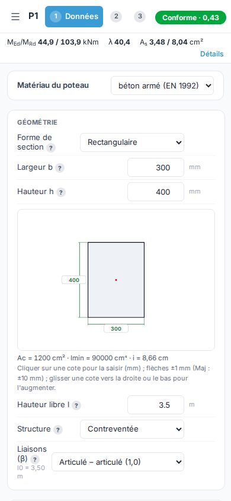

*Figure 12 — Affichage sur téléphone : résultats principaux sous l'en-tête, détail dans un tiroir.*

Le bouton **☰** ouvre la liste des poteaux et les réglages. Sous l'en-tête, une bande rappelle MEd/MRd, λ et As ; **Détails** ouvre le panneau de résultats complet. `Échap` ferme les tiroirs.

## 12. Méthodes de calcul (résumé)

- **Matériaux** : diagramme parabole-rectangle du béton, acier à palier horizontal (EC2 §3.1.7, §3.2.7).
- **Imperfections** : ei = αh·l0/400 (§5.2).
- **Second ordre** : courbure nominale, MEd = max(M02 ; M0e + M2 ; M01 + 0,5 M2 ; NEd·e0) (§5.8.8) ; rigidité nominale en option (§5.8.7) ; fluage selon l'annexe B.
- **Résistance** : diagramme d'interaction N-M exact de la section armée, dans chaque direction ; flexion déviée par la relation 5.39.
- **Durabilité** : enrobage selon les tableaux 4.3N/4.3NF et 4.4N ; ELS selon §7.2 et §7.3.4 ; feu selon l'EN 1992-1-2 méthode A.

Le détail des formules, articles et hypothèses figure dans `MANUAL.md` et dans les documents d'audit (`docs/audit/` : matrice normative, registre des formules, cahier de validation).

## 13. Dépannage et questions fréquentes

| Situation | Solution |
|---|---|
| Impossible d'imprimer la note en PDF (Edge, stratégie d'entreprise) | Utiliser **Télécharger la note (PDF)** : le PDF est produit par l'application, sans boîte d'impression. |
| L'aperçu ne s'ouvre pas | Autoriser les fenêtres surgissantes pour l'application ; à défaut, l'aperçu est téléchargé en fichier HTML. |
| Projet volumineux | La note de 20 poteaux (environ 160 pages) est produite en arrière-plan en une quinzaine de secondes ; l'application reste utilisable pendant ce temps. |
| Verdict « Non vérifié » | Une donnée est invalide : lire le cadre « Données à corriger » ; le champ fautif est encadré en rouge. |
| Bandeau « navigateur trop ancien » | Mettre à jour le navigateur (Chrome ou Edge 111+, Firefox 128+, Safari 16.4+). |
| Un réglage avancé semble sans effet | Vérifier le résumé du panneau fermé et le compteur « réglages modifiés » ; certaines grandeurs (effort tranchant faible) n'influent que sur les vérifications concernées. |
| Le logo n'apparaît pas dans le DXF | Le format DXF R12 n'incorpore pas d'image : utiliser l'export « DXF + logo (ZIP) » et insérer le fichier dans le cadre LOGO. |
| Anomalie ou erreur d'affichage | Réglages → Diagnostic → Télécharger le rapport, et le joindre au signalement. |
| `npm` n'est pas reconnu (Windows) | Fermer et rouvrir le terminal après l'installation de Node.js, ou redémarrer. |

## 14. Glossaire des notations

| Notation | Signification |
|---|---|
| NEd, MEd | Effort normal et moment de calcul à l'ELU |
| MRd | Moment résistant de la section pour NEd |
| M01, M02 | Moments du premier ordre aux extrémités (/M02/ ≥ /M01/), imperfection incluse |
| M0e | Moment équivalent du premier ordre |
| M2, e2 | Moment et excentricité du second ordre |
| λ, λlim | Élancement et élancement limite |
| l0 | Longueur efficace |
| φef | Coefficient de fluage effectif |
| cnom | Enrobage nominal |
| As, ρ | Section et pourcentage d'acier longitudinal |
| lbd, l0 | Longueurs d'ancrage et de recouvrement |
| ψ1, ψ2 | Coefficients des valeurs fréquente et quasi-permanente |
| R | Durée de résistance au feu (minutes) |
| wk | Ouverture calculée des fissures |

## 15. Historique des versions

| Version | Principaux apports |
|---|---|
| 3.15 | Logo S.E.L. dans le menu, l'onglet du navigateur et tous les projets |
| 3.14 | Identité Structural & Engineering Labs : cartouche à trois cellules, logo vectoriel (note, plans, DXF), copyright |
| 3.13 | Note de calcul et plans A3 téléchargés directement en PDF, quel que soit le navigateur ; identifiant de calcul, données d'entrée en annexe |
| 3.12 | Suppression de l'ancienne interface détaillée : une seule interface |
| 3.11 | Aide contextuelle des champs, manuel illustré (application, Markdown, PDF), raccourcis clavier |
| 3.10 | Plans : cotes de position, hachures, nomenclature façonnée, cartouche DXF à attributs, logo |
| 3.9 | Tests de bout en bout, affichage téléphone et tablette, fonctionnement hors ligne |
| 3.8 | Panneaux repliables fiabilisés, robustesse, diagnostic |
| 3.7 | Note de calcul paginée, cartouche paramétrable |
| 3.6 | Audit normatif : 14 écarts corrigés, cahier de validation |
| 3.5 | Interface compacte en 4 étapes, projets multi-poteaux |
| 3.4 | Toutes formes de section, plan A3 et DXF |
| 3.0 à 3.3 | Moteur de calcul refondu et validé ; second ordre, feu, fissuration, Annexe française |

Le détail figure dans le fichier `CHANGELOG.md`.
